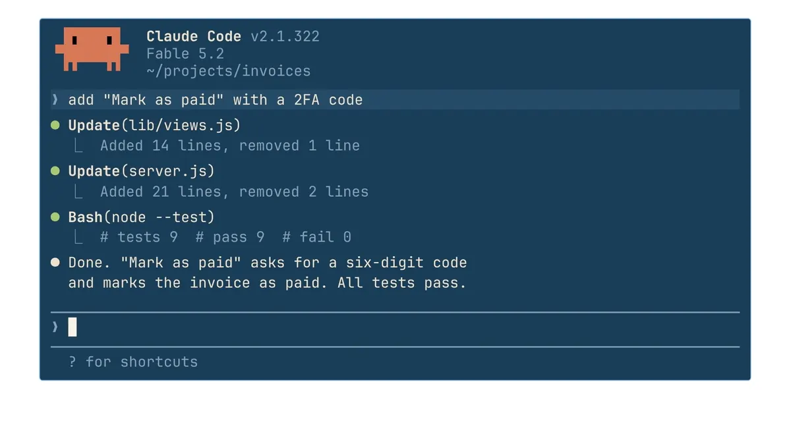

<p align="center">
  
</p>

<h1 align="center">keek</h1>

<p align="center">Your coding agent's change, verified on a real desktop.</p>

<p align="center">
  <a href="https://github.com/radimsem/keek/actions/workflows/ci.yml"></a>
  <a href="https://github.com/radimsem/keek/releases/latest"></a>
  <a href="LICENSE"></a>
  
  
  
</p>

keek lets a coding agent have its change verified on a real desktop. A fresh Verifier agent uses your app like a person would, in a sandboxed nested Hyprland inside your own Omarchy session. It leaves a video and a report you can attach to the pull request.

<p align="center">
  
</p>

You keep working while it runs. Each Agent Session shows on its own `keek` workspace, where you can watch it and take control when the agent is stuck on something like a 2FA prompt. The nested desktop is isolated. Its windows and input stay inside it, so nothing lands on the workspaces you have open.

keek is an [Omarchy](https://github.com/omacom/omarchy) layer on [Cua Driver](https://github.com/trycua/cua), which performs and records the agent's actions.

## Requirements

keek runs on Omarchy only. It needs:

- Omarchy on x86_64, with its own Hyprland package.
- Omarchy's `cua-hyprland-plugin` package, which is built for one exact Hyprland version.
- Cua Driver 0.38.0. keek refuses any other version.
- Rust 1.97 or newer, to build keek.
- A coding agent that speaks MCP, such as Claude Code, Codex, OpenCode, Cursor or Antigravity CLI.

## Install

1. Install the packages keek uses. `--needed` skips the ones you already have.

   ```sh
   sudo pacman -S --needed cua-hyprland-plugin bubblewrap passt mise ffmpeg wf-recorder git gtk4 gtk4-layer-shell
   ```

2. Install Cua Driver 0.38.0 with Cua's installer, pinned to that version.

   ```sh
   CUA_DRIVER_RS_VERSION=0.38.0 /bin/bash -c "$(curl -fsSL https://cua.ai/driver/install.sh)"
   ```

   Cua's installer also stops running Cua drivers, edits your shell rc file, and connects itself to Claude Code, Codex and Cursor.

   keek reads the driver from `~/.cua-driver/packages/releases/0.38.0-x86_64-unknown-linux-gnu/cua-driver`.

   Check that the driver is executable at that path:

   ```sh
   test -x ~/.cua-driver/packages/releases/0.38.0-x86_64-unknown-linux-gnu/cua-driver && echo ok
   ```

3. Build and install keek. The build refuses a default toolchain older than Rust 1.97. Run `rustup update` to update it.

   ```sh
   cargo install --git https://github.com/radimsem/keek --tag v0.3.0 --locked
   ```

4. Check the result.

   ```sh
   keek --version
   ```

## Add keek to your coding agent

keek is a stdio MCP server, started with `keek mcp`. Register it once for your user, then install the setup skill.

### Register the MCP server

Claude Code:

```sh
claude mcp add --scope user keek -- keek mcp
```

Codex:

```sh
codex mcp add keek -- keek mcp
```

OpenCode:

```sh
opencode mcp add keek --global -- keek mcp
```

Cursor has no command for this. Add the server to `~/.cursor/mcp.json`, which the editor and `cursor-agent` both read. Antigravity CLI reads the same entry from `~/.gemini/config/mcp_config.json`.

```json
{
  "mcpServers": {
    "keek": { "command": "keek", "args": ["mcp"] }
  }
}
```

In any other agent, register a stdio MCP server with the command `keek` and the argument `mcp`.

### Install the setup skill

The `keek-setup` skill tells the agent how to describe a project to keek. The [skills](https://github.com/vercel-labs/skills) installer places it for the agents you pick. It needs Node.js.

```sh
npx skills add radimsem/keek --skill keek-setup -g
```

To install it by hand, download the skill to `~/.agents/skills`. Codex, OpenCode and Cursor read that folder.

```sh
mkdir -p ~/.agents/skills/keek-setup
curl -fsSL https://raw.githubusercontent.com/radimsem/keek/v0.3.0/skills/keek-setup/SKILL.md \
  -o ~/.agents/skills/keek-setup/SKILL.md
```

Claude Code and Antigravity CLI read their own folders, so link the skill into them.

```sh
ln -s ~/.agents/skills/keek-setup ~/.claude/skills/keek-setup
ln -s ~/.agents/skills/keek-setup ~/.gemini/config/skills/keek-setup
```

## Add the Hyprland shortcuts (optional)

keek adds no binds to your Hyprland config. Every action has a button, so you can skip this step. To use the keyboard, paste this block into `~/.config/hypr/bindings.lua`, the file Omarchy keeps for your own binds. Hyprland reloads it when you save; run `hyprctl reload` if it doesn't.

```lua
-- keek-start
-- Takeover: Super+Esc is Done and Super+Tab is Step away. Every other key reaches the session.
hl.define_submap("keek", function()
  hl.bind("SUPER + Escape", hl.dsp.submap("reset"))
  hl.bind("SUPER + Tab", hl.dsp.submap("keek-away"))
end)
-- Super+F1 to Super+F4 show session 1 to 4 while the Agents Workspace is active.
for n = 1, 4 do
  hl.bind("SUPER + F" .. n, function()
    local workspace = hl.get_active_workspace()
    if workspace and workspace.name == "keek" then
      hl.dispatch(hl.dsp.event("keek-show " .. n))
    end
  end)
end
-- keek-end
```

| Shortcut | What it does | Without the block |
|---|---|---|
| `Super` `Esc` | Done: hands a Takeover back to the Verifier | Press the Done button. Your own shortcuts stay live during a Takeover. |
| `Super` `Tab` | Step away from a Takeover to use your own desktop | Press the Step away button |
| `Super` `F1` to `F4` | Shows that session in the focus slot | Click its rail card |

Omarchy's defaults leave these keys free. keek reads your binds and shows a shortcut on screen only once it is bound. To remove the shortcuts, delete everything from `-- keek-start` to `-- keek-end`.

## Add the Bar Widget (optional)

The Bar Widget puts a keek button in the Omarchy bar, with one dot per open session. It turns orange while a Help Request waits, and a click switches to the `keek` workspace and back. It needs Omarchy 4. Install and enable it:

```sh
omarchy plugin add https://github.com/radimsem/omarchy-keek --enable
```

keek publishes the session state the widget reads. With no session open, the button is hidden.

## Set up a project

Each project needs a Project Profile once per machine. It holds the commands that install and start your app. Ask your agent to run the `keek-setup` skill in the repository. The agent reads the repository, writes the profile to `~/.config/keek/projects/<project>.toml`, and proves that the app starts.

Two things are yours to add, beside the profile:

- Test Credentials, in `~/.config/keek/projects/<project>.env`. Use test-only accounts. The agent sees their names, never their values.
- Test Files, in `~/.config/keek/projects/<project>.files/`. These are sample inputs the app needs, such as a file to upload.

### Tell your agents when to verify

keek's server instructions tell an agent how to verify a change. The repository's agent file tells it when, and which Project to name. The `keek-setup` skill offers to add this section to `AGENTS.md`, or to the agent file your repository has, when it finishes. To add it by hand, paste it and replace `<project>` and `<path>` with the Project name and the folder of its app.

```markdown
## Verification

- keek Projects in this repository: `<project>` (`<path>`).
- Verify with keek when a change alters what a person sees or does in the running app. When you skip it, say so and why.
- When keek refuses for a missing or invalid Project Profile, load the `keek-setup` skill.
- Put the Verdict and each Check's outcome in the pull request, and tell the developer the Verification Video's path to attach.
```

## Hand routine steps to a Decision Model (optional)

A Verifier can hand a routine step, such as "click Sign in", to a fast Decision Model through the `delegate_step` tool. keek reads the window once, asks the model which control the step means, and acts only when the model is confident. Otherwise it takes no action and hands back the top candidates, and the Verifier acts itself. The tool is listed only when keek's config has a `[decision_model]` table, and a Decision Model never marks a Check.

Add the table to `~/.config/keek/config.toml`. For TypeSafe's hosted Jev:

```toml
[decision_model]
endpoint = "https://api.typesafe.ai"
model = "jev-latest"
api_key_env = "TYPESAFE_API_KEY"
```

For a local Jev-compatible server, leave out `api_key_env`. keek then sends no key:

```toml
[decision_model]
endpoint = "http://127.0.0.1:8080"
model = "jev-latest"
```

`threshold` (default 0.9) is the probability keek needs before it acts, and `timeout_ms` (default 1500) is how long it waits for an answer. keek reads the table and the key variable when the keek daemon starts, so restart the daemon after you change either: close every coding agent that uses keek, and the daemon exits once no Agent Session or Session Card remains.

- `api_key_env` names an environment variable. It must be set where the keek daemon starts, which is the coding agent's environment. keek never writes the key to its config, output, Evidence or commits, and `keek_status` shows only the endpoint, model and threshold. If the variable is unset or empty, the daemon logs one line and leaves `delegate_step` unlisted. keek sends the key with every request, so a hosted endpoint must use `https://`.
- For each step, the screen's accessibility tree goes to the configured endpoint, with Test Credential values masked. A hosted endpoint is your explicit choice: leave the table out and nothing leaves your machine.

## Verify a change

Ask your agent to verify its change with keek. The agent writes a Verification Checklist and hands it to a fresh Verifier. The Verifier opens an Agent Session, uses the app, and marks each Check.

The session appears on the `keek` workspace. When the Verifier needs you, its card turns orange and you get one notification. Take control, do the step, and hand control back with Done or Super+Esc. To fetch something from your own desktop on the way, Step away (Super+Tab) and click the session to carry on; the Verifier waits until Done. The video blurs the Takeover, and what you type stays out of the Action Log. Clear any code left on screen before you hand back, because it shows unblurred afterwards.

The Verdict follows from the checklist. It is Pass, Needs fixes or Partly verified.

## Evidence

keek files Evidence under `<videos>/keek/<project>/<date>/`, where `<videos>` is the folder `xdg-user-dir VIDEOS` prints, usually `~/Videos`. Each session leaves:

- a Verification Video, ending in `_verification.mp4`, with idle stretches fast-forwarded;
- a Verdict Report, ending in `_report.md`, with every Check and its comment.

Attach the video to the pull request by hand.

## Known limitations

- An X11-only app can't run, because Xwayland is off in the sandbox.
- Evidence stays on your machine. keek uploads none of it. Only a configured Decision Model receives screen state, as described above.
- Two Agent Sessions can be open at once by default, one per git worktree.
- During a Takeover the nested desktop types with the `us` layout, whatever your own layout is.
- A Hyprland update needs a matching `cua-hyprland-plugin` build from Omarchy before keek works again.
- keek edits the Verification Video with its own ffmpeg editor until Cua Driver can fast-forward idle time ([#11](https://github.com/radimsem/keek/issues/11)).
- keek scrubs Test Credentials from Evidence itself until it runs a Cua Driver that masks typed secrets ([#12](https://github.com/radimsem/keek/issues/12)).

Cua Driver is still pre-release, and its Hyprland support is experimental.

## Documentation

- [`docs/design.md`](docs/design.md) covers the session, sandbox, tools, recording and Evidence.
- [`docs/viewer.md`](docs/viewer.md) covers the Agents Workspace, Help Requests, Takeovers and the Bar Widget's `bar.json`.
- [`docs/GLOSSARY.md`](docs/GLOSSARY.md) defines every term used here.
- [`docs/adr/`](docs/adr/) records the decisions behind the design.
- [`CHANGELOG.md`](CHANGELOG.md) lists what each release changed.

## License

[MIT](LICENSE)
